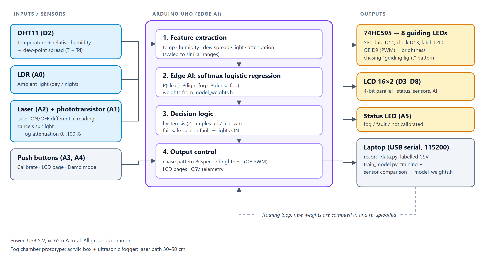
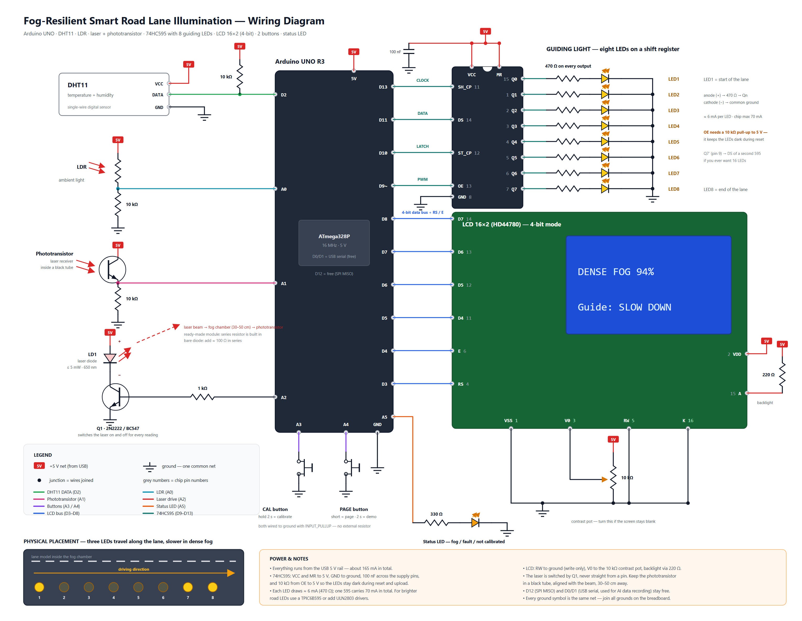

# Fog-Resilient Smart Road Lane Illumination (Arduino Uno)

Sistem lampu pemandu jalur jalan yang menyala otomatis saat kabut. Arduino Uno membaca 5 parameter
(suhu, kelembapan, dew-point spread, cahaya sekitar, pelemahan laser), memutuskan **CLEAR / LIGHT FOG /
DENSE FOG** dengan **edge AI** (softmax logistic regression), lalu menjalankan pola *guiding light* pada
8 LED melalui 74HC595 dan menampilkan status di LCD 16×2.

## Isi folder
| Path | Keterangan |
|---|---|
| `firmware/fog_illumination_uno/` | Firmware Uno: `.ino`, `config.h` (pin, timing, threshold), `model_weights.h` (bobot AI) |
| `tools/record_data.py` | Rekam data berlabel dari Uno lewat USB → `data/train_*.csv` |
| `tools/train_model.py` | Training AI + perbandingan sensor → `model_weights.h` |
| `tools/serial_port.py` | Akses port serial tanpa install library (dipakai kedua tools di atas) |
| `RECORD_DATA.bat` / `TRAIN_MODEL.bat` | Klik dua kali untuk menjalankan tools |
| `START_DASHBOARD.bat` | Dashboard PC: pantau dan atur Uno lewat USB (lihat bagian 7) |
| `dashboard/` | `server.py` (server + serial), `simulator.py` (kembaran firmware tanpa hardware), `drivers.py` (bantuan driver USB-serial), `static/index.html` (halaman) |
| `drivers/` | Taruh installer/driver USB-serial yang Anda unduh dari situs vendor (lihat bagian 7); tidak dijalankan otomatis |
| `docs/` | Wiring diagram, block diagram, flowchart (SVG + PNG). Wiring dibuat ulang dengan `python docs/gen_wiring.py` |
| `proposal/` | Proposal final (.docx) |

## 1. Wiring

| Pin | Ke | Pin | Ke |
|---|---|---|---|
| D2 | DHT11 DATA | A0 | LDR (pembagi 10 kΩ) |
| D3–D8 | LCD RS, E, D4, D5, D6, D7 | A1 | Phototransistor (emitter + 10 kΩ ke GND) |
| D9 | 595 OE (pin 13) — PWM kecerahan | A2 | Laser lewat NPN 2N2222 |
| D10 | 595 ST_CP (pin 12) | A3 | Tombol CAL → GND |
| D11 | 595 DS (pin 14) | A4 | Tombol PAGE → GND |
| D13 | 595 SH_CP (pin 11) | A5 | Status LED + 330 Ω |

Catatan:
- 595: VCC(16) & MR(10) ke 5V, GND(8) ke GND, kapasitor 0,1 µF dekat VCC, resistor **10 kΩ dari OE ke 5V**
  (supaya LED mati saat Arduino baru menyala). LED1…LED8 di Q0…Q7, tiap LED **470 Ω – 1 kΩ** ke GND.
- LCD: RW(5) ke GND, V0(3) ke kaki tengah potensiometer 10 kΩ, backlight A(15) lewat 220 Ω ke 5V.
  **Layar kosong / kotak hitam = putar potensiometer kontras.**
- Laser 2 kabel: + ke 5V, − ke collector 2N2222, emitter ke GND, basis lewat 1 kΩ ke A2.
  Modul KY-008 (3 pin): pin S tetap lewat transistor, jangan langsung dari pin Arduino bila arusnya > 20 mA.
- Phototransistor dimasukkan ke **tabung hitam** (sedotan hitam / selongsong) dan diarahkan tepat ke laser,
  jarak 30–50 cm melintasi fog chamber.

## 2. Upload firmware
1. Buka `firmware/fog_illumination_uno/fog_illumination_uno.ino` di Arduino IDE.
2. Board: **Arduino Uno**, pilih port COM-nya, klik Upload.
   Tidak perlu install library (SPI, EEPROM, LiquidCrystal sudah bawaan; DHT11 dibaca dengan kode sendiri).
3. Saat menyala: LCD menampilkan versi, 8 LED menyala bergantian satu kali (lamp test).

## 3. Kalibrasi laser (wajib sekali, tersimpan di EEPROM)
Dalam kondisi **udara bersih**, laser sudah lurus ke phototransistor:
- tahan tombol **CAL 2 detik**, atau kirim `c` dari Serial Monitor (115200).
- LCD: `CAL OK Baseline xxx`. Jika `CAL FAILED` → sinyal terlalu kecil, luruskan laser / periksa tabung.
- Kalibrasi juga ditolak (`CAL FAILED`) bila: kelembapan > 85 % (`Air not clear` = udara belum bersih), 8 bacaan laser tidak stabil (`Signal unstable`, selisih > 10 %), atau receiver jenuh (`Rx saturated`; beri naungan atau kecilkan resistor beban).

Ulangi kalibrasi setiap kali posisi laser atau receiver bergeser.

## 4. Pemakaian
| Tombol | Aksi |
|---|---|
| PAGE tekan singkat | Ganti halaman LCD (status → T/H/dew → laser/cahaya → probabilitas AI) |
| PAGE tahan 2 s | **Demo mode**: berganti CLEAR → LIGHT → DENSE → FAULT tiap 5 s (untuk presentasi) |
| CAL tahan 2 s | Kalibrasi laser |

| Status | Guiding lights |
|---|---|
| CLEAR | Mati |
| LIGHT FOG | 3 LED berjalan, 150 ms/langkah, kecerahan sedang |
| DENSE FOG | 3 LED berjalan **lebih lambat** (300 ms) = isyarat kurangi kecepatan, kecerahan penuh |
| SENSOR FAULT | Semua LED berkedip, kecerahan penuh (**fail-safe**) |

Malam hari (LDR gelap) kecerahan otomatis diturunkan ke 60 % agar tidak silau di kabut.
Semua angka ini bisa diubah di `config.h`.

Fault terdeteksi bila: DHT11 gagal dibaca 3× berturut-turut, atau sinyal laser < 5 % baseline padahal
kelembapan < 85 % **dan bacaan DHT11 masih segar** (tidak mungkin kabut → laser terhalang/bergeser).

Mode SENSOR FAULT (semua LED berkedip) hanya aktif bila laser rusak, atau DHT11 gagal saat sistem belum
terkalibrasi. Bila DHT11 gagal tetapi laser sudah terkalibrasi (sering terjadi di kabut), sistem tetap
memakai laser untuk mendeteksi kabut; LED status berkedip cepat sebagai tanda DHT11 bermasalah.
Selama **belum terkalibrasi**, lampu tidak pernah mati: status minimal LIGHT FOG.

Perintah Serial Monitor: `c` kalibrasi, `d` demo, `p` halaman LCD, `i` info model, `h` bantuan.

## 5. Rekam data untuk AI
Tutup Serial Monitor Arduino dulu (port hanya bisa dipakai satu program), lalu klik dua kali
`RECORD_DATA.bat` (atau `python tools/record_data.py --note humid_nofog`).

| Tombol | Aksi |
|---|---|
| `0` / `1` / `2` | Rekam sebagai clear / light fog / dense fog |
| `spasi` | Pause (tidak merekam) |
| `n` | Ganti catatan skenario |
| `c` | Kalibrasi device |
| `q` | Selesai & simpan |

Rekam **semua skenario** berikut (± 3–5 menit masing-masing, beri catatan `n`):

| Catatan | Kondisi | Label |
|---|---|---|
| `dry_clear` | Udara bersih, ruangan normal | 0 |
| `humid_nofog` | Setelah kabut hilang, RH masih tinggi | 0 |
| `dark_nofog` | Lampu ruangan mati / LDR ditutup | 0 |
| `light_fog` | Kabut tipis (att ± 15–50 %) | 1 |
| `dense_fog` | Kabut tebal (att > 50 %) | 2 |

Kasus menjebak (`humid_nofog`, `dark_nofog`) penting: tanpa itu AI bisa "curang" hanya melihat kelembapan.
Baris saat fault atau demo mode otomatis tidak direkam.

## 6. Training & perbandingan sensor
Klik dua kali `TRAIN_MODEL.bat` (= `python tools/train_model.py --compare --install`). Hasilnya:
- akurasi, confusion matrix, recall tiap kelas (target recall dense fog ≥ 90 %);
- **tabel perbandingan sensor**: tiap sensor sendiri vs kombinasi vs fusion 5 parameter, plus
  "drop-one test" → disimpan ke `data/sensor_comparison.csv` untuk bab hasil di laporan;
- `model_weights.h` baru langsung ditulis ke folder firmware.

Lalu **upload ulang firmware** dari Arduino IDE. Tanpa `--install`, hasilnya hanya disimpan di `data/`.

## 7. Dashboard di PC (pantau + atur lewat USB serial)
Klik dua kali `START_DASHBOARD.bat` (atau `python dashboard/server.py --open`). Halaman terbuka di
`http://localhost:5200`. Hanya Python 3 yang dibutuhkan (tanpa `pip install`); server hanya menerima koneksi dari PC ini.

- Satu Arduino-like di COM terdeteksi → tersambung otomatis. Jika tidak: **Settings → Connection**, pilih port, **Connect**.
- Tidak punya Uno? **Use simulator**: kembaran firmware dengan skenario (clear, light, dense, humid_nofog, malam,
  DHT11 mati, laser terhalang, receiver jenuh, …). Aturannya sama dengan firmware, jadi tombol, fault, dan kalibrasi berperilaku sama.
- Opsi baris perintah: `--port COM7`, `--sim`, `--scenario dense`, `--speed 5`, `--http-port 5200`.

| Halaman | Isi |
|---|---|
| **Live** | Status kabut (CLEAR/LIGHT/DENSE/FAULT) + keyakinan AI, adegan jalan dengan 8 LED, jalur laser, DHT11 dan LDR; suhu, kelembapan, dew spread, cahaya, sinyal laser, atenuasi; probabilitas; 5 fitur model; kesehatan perangkat (DHT11, laser, receiver, kalibrasi, kecerahan); banner mode degradasi; tombol **Calibrate**, **Demo**, **Next LCD page**, **Info**; grafik |
| **Sensors** | Grafik suhu/dew spread, kelembapan, sinyal laser vs baseline, cahaya vs kecerahan lampu (1 menit - 1 jam); rumus fitur; baris data mentah terakhir |
| **Settings** | Koneksi; **pengaturan perangkat** (tersimpan di EEPROM Uno, bertahan saat mati): kecerahan light/dense, ambang dan kecerahan malam, jumlah sampel konfirmasi naik/turun, kecepatan chase |
| **Log & Record** | Daftar event (perubahan state, fault, kalibrasi, pengaturan, perintah; bisa diunduh CSV), pesan serial `#`, dan **rekam data latih** ke `data/train_*.csv` (format sama dengan `RECORD_DATA.bat`, langsung bisa `TRAIN_MODEL.bat`). Rekaman dari simulator disimpan sebagai `sim_*.csv` dan tidak dipakai training |

### Driver USB-serial (CH340 / CP210x / FTDI / Arduino)
Jika Uno sudah dicolok tetapi tidak ada port COM, buka **Settings → USB-serial driver**. Dashboard membaca daftar perangkat USB
Windows dan menunjukkan chip (CH340/CH341, CP210x, FTDI, Arduino 16U2, ...) dengan status **driver installed / missing / problem**.
Jika driver belum terpasang:
1. Pastikan kabel USB adalah kabel **data** (sebagian kabel hanya untuk charger).
2. Klik **Scan for hardware changes**. Windows Update sering memasang driver CH340 sendiri (butuh internet). Windows meminta persetujuan administrator (UAC).
3. Jika masih "driver missing", klik tautan halaman resmi vendor di kartu itu (WCH untuk CH340, Silicon Labs untuk CP210x, FTDI, Arduino) dan unduh driver-nya sendiri.
   Jalankan installer-nya, **atau** taruh installer (`.exe`) / folder driver (berisi `.inf`, hasil unzip) di folder `drivers/` lalu klik **Install...**
   (installer dijalankan dengan UAC; dashboard menampilkan tanda tangan digital dan SHA-256 untuk Anda periksa). File `.zip` harus di-unzip dulu.
4. Klik **Rescan**; status berubah menjadi *driver installed* dan muncul nomor COM. Lalu **Connect**.

Dashboard tidak pernah mengunduh atau menjalankan file dari internet sendiri; hanya membuka halaman vendor dan menjalankan file yang Anda taruh di `drivers/`,
setelah Anda menyetujui UAC. Fitur ini hanya untuk Windows; mode simulator tidak butuh driver.

**Protokol serial** (115200 baud). Firmware menambah tiga hal, perintah lama `c d p i h` dan baris `H,`/`D,` tidak berubah:

| Arah | Teks | Arti |
|---|---|---|
| PC → Uno | `!get` · `!set key=nilai` · `!reset` | baca / ubah / kembalikan default pengaturan perangkat |
| Uno → PC | `S,mode,bright,calibrated,dhtFails,rxSat` | tiap sampel: mode lampu (0 clear, 1 light, 2 dense, 3 fault), kecerahan 0-255, kesehatan |
| Uno → PC | `C,key=nilai,...` | pengaturan perangkat saat ini (saat boot dan setelah `!get`/`!set`) |

Kunci pengaturan (nilai di luar batas dipotong): `brightLight` 0-255, `brightDense` 0-255, `nightPct` 0-100,
`nightScale` 0-100, `confirmUp` 1-20, `confirmDown` 1-20, `stepLight` 50-1000, `stepDense` 50-2000.
Default berasal dari `config.h`. Di Serial Monitor Arduino, perintah `!` harus diakhiri newline (pilih "Newline"),
dan di dashboard tidak perlu apa-apa. Pin, aturan fault, dan bobot AI tetap diatur di firmware (`config.h`, `TRAIN_MODEL.bat`).

Catatan: dashboard, `RECORD_DATA.bat`, dan Serial Monitor memakai port COM yang sama; hanya satu yang boleh aktif.
Menyambung membuat Uno restart (data muncul setelah ±3 detik). Di dashboard, perintah demo bersifat on/off;
tombol "Next LCD page" tidak berpengaruh di simulator (tidak ada LCD).

## Troubleshooting
| Gejala | Penyebab / solusi |
|---|---|
| LCD kotak hitam / kosong | Putar potensiometer kontras; cek RW ke GND |
| `!! SENSOR FAULT DHT11` | Kabel data DHT11 ke D2, pull-up 10 kΩ (sensor tanpa modul). Muncul hanya bila belum terkalibrasi; bila sudah terkalibrasi, DHT11 gagal hanya membuat LED status berkedip cepat |
| `!! SENSOR FAULT LASER` | Laser terhalang/bergeser → luruskan, kalibrasi ulang |
| `NOT CALIBRATED` bergantian di LCD | Belum kalibrasi → tahan CAL 2 s di udara bersih. Selama itu lampu menyala minimal LIGHT FOG |
| LED tidak menyala sama sekali | Cek OE (D9), MR ke 5V, latch D10; coba demo mode |
| Recorder: "port is busy" | Tutup Serial Monitor / Serial Plotter Arduino IDE |
| Dashboard: "Cannot open COMx ... port is busy" | Tutup Serial Monitor, `RECORD_DATA.bat`, atau dashboard lain yang memakai port itu |
| Dashboard: tidak ada port COM / "driver missing" | Settings → USB-serial driver (bagian 7): Scan for hardware changes, atau pasang driver CH340/CP210x/FTDI dari situs vendor |
| Dashboard: banner "firmware does not send the status line" | Firmware Uno lama: upload ulang `firmware/fog_illumination_uno` (butuh baris `S,` dan perintah `!set`) |
| Sinyal laser berubah-ubah saat cahaya ruangan berubah | Normal sedikit; perbaiki tabung hitam receiver |
